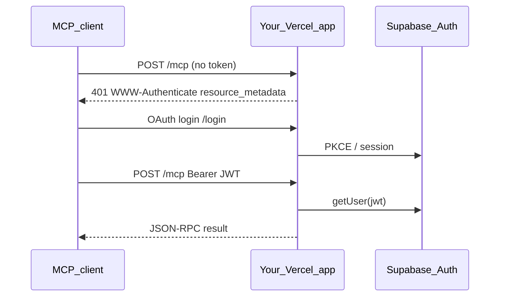

# Authentication

## Model

Deployed MCP uses **Supabase Auth** as the identity provider. Every `POST /mcp` request must carry a **Bearer JWT** (Supabase session access token). The package validates via `supabase.auth.getUser(jwt)` using the **anon key**—never the service role at the request gate.



## `withSupabaseMcpAuth`

- Returns **401** with OAuth `WWW-Authenticate` + `resource_metadata` when token missing/invalid (if `required: true`)
- Returns **403** when `requiredScopes` not satisfied
- Sets `req.auth` (`AuthInfo` from MCP SDK) on success

Default scopes on verified tokens: **`["mcp"]`**. Customize:

```typescript
createMcpPostHandler({
  server: myMcpServer,
  auth: { defaultScopes: ["my-app.mcp"], requiredScopes: ["my-app.mcp"] },
});
```

## OAuth protected resource metadata

Expose [`example/api/oauth-protected-resource.ts`](../example/api/oauth-protected-resource.ts) at `/.well-known/oauth-protected-resource` (via `vercel.json` rewrite). Uses `mcp-handler` + `resolveSupabaseAuthServerUrl()`.

## Browser login UI

Static pages under `example/public/` implement login + OAuth consent against Supabase Auth OAuth APIs. Not part of the npm runtime deps—copy into your consumer repo.

## RLS in tool handlers

The package does **not** create RLS-scoped Supabase clients for your domain. In `callTool`, use the JWT from `auth.token` (or `runWithMcpJwt` in your wrapper) to call Supabase with user context.

## Further reading

Consumer wiring: [integrate-your-app.md](./integrate-your-app.md)
