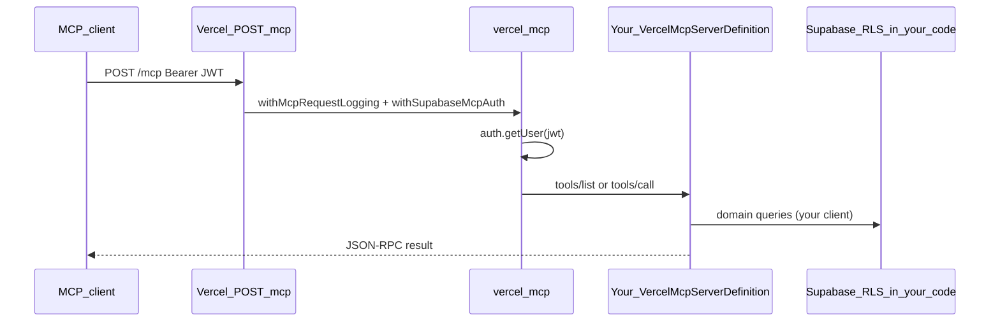

# Getting started

## What problem this solves

`@medallo-dev/vercel-mcp` is an internal library for hosting a **Model Context Protocol (MCP)** server on **Vercel** with **Supabase** as the identity provider. You get JWT validation, OAuth metadata, structured logging, optional audit logging, and a generic JSON-RPC router—without building a bespoke auth server.

## Architecture

## What you implement vs what the package provides

| You implement (consumer repo) | Package provides |
| --- | --- |
| `VercelMcpServerDefinition` (tools + business logic) | Supabase JWT gate (`withSupabaseMcpAuth`) |
| RLS-scoped Supabase client in tool handlers | JSON-RPC (`initialize`, `tools/list`, `tools/call`, `ping`, …) |
| Vercel `api/` routes (thin wrappers) | Request logging (Pino + request IDs) |
| OAuth login/consent UI (copy from `example/public/`) | Optional `mcp.interaction_log` audit |
| Domain database schema | Hand-maintained `schema/mcp.sql` for audit only |

## Next step

Follow [integrate-your-app.md](./integrate-your-app.md) to wire a consumer app end-to-end.

Reference implementation: [`example/`](../example/) in this repository.
